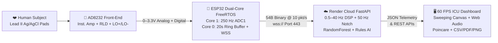

# 🫀 HEARTIX — Real-Time IoT Biomedical ECG Telemetry & ICU Monitor

[](https://heartix.onrender.com/)
[](firmware/heartix_esp32/heartix_esp32.ino)
[](main.py)
[](https://github.com/santrex-create/HEARTIX/actions/workflows/ci.yml)

**HEARTIX** is an end-to-end Internet of Things (IoT) biomedical telemetry platform that captures live **Lead II Electrocardiogram (ECG)** waveforms using an **AD8232** analog front-end and an **ESP32** microcontroller, streams ultra-compact **54-byte binary packets** over encrypted **TLS WebSockets (`wss://`)** to a **FastAPI** cloud backend, and renders a hospital-style **60 FPS ICU bedside monitor** in any web browser.

---

> [!CAUTION]
> ### ⚡ CRITICAL ELECTRICAL SAFETY & MEDICAL DISCLAIMER
> * 🚫 **NEVER** connect the ESP32 to a mains-powered USB wall adapter, desktop PC, or plugged-in laptop while AD8232 electrodes are attached to a human body. Mains leakage currents can cause fatal ventricular fibrillation.
> * 🔋 **ALWAYS** power the ESP32 exclusively from an **isolated USB power bank or LiPo battery** during human measurements (and run any laptop strictly on battery power).
> * 🎓 Built strictly for **educational, biomedical engineering, and research prototyping**. Not a certified medical device.

---

## 🏗️ System Architecture



---

## ✨ Key Features

* ⚡ **Deterministic 250 Hz Dual-Core FreeRTOS Firmware:** Separates strict 4 ms ADC1 sampling (Core 1) from Wi-Fi/TLS networking (Core 0) with lock-free double buffering and a **20-second (200-packet) SRAM offline ring buffer**.
* 📦 **54-Byte Little-Endian Binary Protocol:** Transmits 25 factory-calibrated millivolt samples, sequence numbers, and hardware leads-off flags at `10 pkt/s` (`540 B/s` total payload).
* 📊 **Real-Time Dual-Path DSP (`ecg_processor.py`):** Causal 10 Hz fast-path filtering + 1 Hz zero-phase `0.5–40 Hz` Butterworth bandpass & `50 Hz` notch filtering, Pan-Tompkins R-peak detection, QRS duration, J+60 ms ST deviation, and continuous parameter display regardless of SQI %.
* 🤖 **Hybrid AI Rhythm Classification (`ai_classifier.py`):** Combines a Random Forest classifier with clinical guardrails, **PVC ectopic beat detection**, **motion-artifact separation**, and 2-window alarm hysteresis.
* 🖥️ **60 FPS Bedside ICU Monitor (`static/`):** Sweeping HTML5 oscilloscope with `25 / 50 mm/s` sweep speeds, `AUTO / 1X / 2X` gain, `1 mV CAL` pulse, **60-second HR trend sparkline**, toggleable **Poincare R-R plot**, **Save PNG**, **Export CSV**, **12-Sec PDF Rhythm Strip**, and **Read-Only Observer Links (`?mode=observer`)**.
* 🔊 **Synthesized Web Audio Engine (`audio_engine.js`):** Zero-asset IEC 60601-1-8 inspired multi-tier clinical alarm chimes, QRS heartbeat tones, and 2-minute ICU audio pause.

---

## 📁 Repository Structure

```text
HEARTIX/
├── .github/workflows/
│   └── ci.yml                  # Automated pytest CI pipeline
├── assets/                     # Dashboard screenshots, GIFs & wiring diagrams
├── docs/
│   └── HARDWARE_BOM.md         # Component bill of materials & specs
├── firmware/heartix_esp32/
│   ├── heartix_esp32.ino       # Dual-core FreeRTOS ESP32 firmware
│   └── secrets.example.h       # Safe Wi-Fi & token template
├── samples/                    # Sample exported CSV & 12-sec PDF strips
├── static/
│   ├── index.html              # ICU bedside monitor UI & dialogs
│   ├── style.css               # Clinical dark-mode & print stylesheet
│   ├── app.js                  # 60 FPS canvas, Poincare plot, WebSocket & exports
│   └── audio_engine.js         # Web Audio API QRS tones & clinical alarms
├── tests/
│   └── test_ecg.py             # Automated DSP & AI classification unit tests
├── ai_classifier.py            # Hybrid RandomForest + clinical rules engine
├── ecg_processor.py            # Dual-path 250 Hz biomedical DSP pipeline
├── ecg_simulator.py            # 9-mode synthetic ECG waveform generator
├── main.py                     # FastAPI server, WSS endpoints & REST APIs
├── render.yaml                 # Render cloud deployment specification
├── requirements.txt            # Python dependencies
└── .env.example                # Environment variable template
```

---

## 🛠️ Hardware Wiring (ESP32 ↔ AD8232)

| AD8232 Pin | ESP32 Pin | Function |
| :--- | :--- | :--- |
| **3.3V** | **3V3** | Strictly 3.3 V power supply *(never connect to 5 V)* |
| **GND** | **GND** | Common ground |
| **OUTPUT** | **GPIO 34** | Calibrated analog ECG input (`ADC1_CH6` — Wi-Fi safe) |
| **LO+** | **GPIO 32** | Leads-off positive comparator |
| **LO-** | **GPIO 33** | Leads-off negative comparator |

* **Lead II Electrodes:** **RA** below right collarbone, **LA** below left collarbone, **RL** (Reference) on lower right abdomen / lower left ribcage.

---

## 🚀 Quick Start

### 1. Local Server & Tests
```bash
git clone [https://github.com/santrex-create/HEARTIX.git](https://github.com/santrex-create/HEARTIX.git)
cd HEARTIX
python -m venv venv
venv\Scripts\activate
pip install -r requirements.txt pytest

pytest -v
uvicorn main:app --host 0.0.0.0 --port 8000 --workers 1
```

### 2. Flash ESP32 Firmware
1. Copy `firmware/heartix_esp32/secrets.example.h` to `firmware/heartix_esp32/secrets.h` and fill in your **2.4 GHz** Wi-Fi credentials, `RENDER_HOST` (`"heartix.onrender.com"`), and `DEVICE_TOKEN`.
2. In Arduino IDE, select **Tools → Board → esp32 → ESP32 Dev Module**, ensure **`WebSockets` by Markus Sattler** is installed, and click **Upload**.